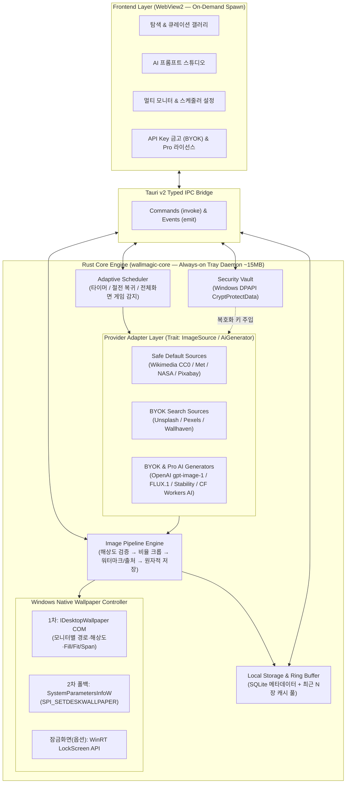
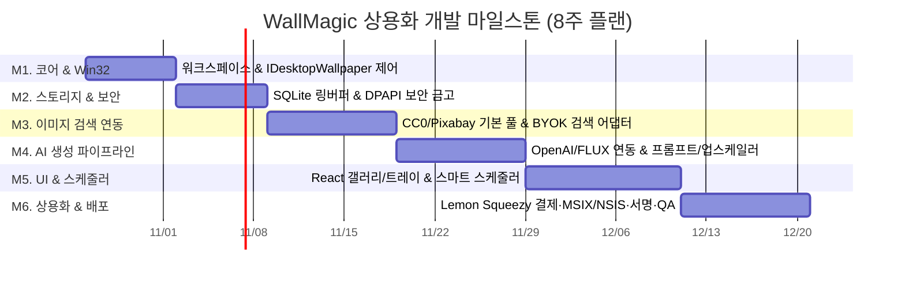

# WallMagic — Windows 지능형 바탕화면 자동 검색·생성·설정 플랫폼 상용화 개발 계획서

> **문서 버전**: v1.0 (Commercial Production Blueprint)  
> **작성 일자**: 2026-10-23  
> **대상 플랫폼**: Windows 10 (1809+) / Windows 11 (x64, ARM64)  
> **문서 목적**: 사용자의 취향 기반 배경화면 자동 검색·AI 생성·네이티브 설정 기능을 갖춘 상용 데스크톱 소프트웨어의 플랫폼 선정, 시스템 아키텍처, API 연동, 수익화·배포, WBS 일정 및 리스크 관리를 정의한 실행 기준서

---

## 1. 개요 (Executive Summary)

**WallMagic**은 Windows PC 사용자의 취향(키워드, 색감, 분위기, 시간대, 모니터 구성)을 분석하여 고해상도 이미지를 **자동으로 검색·큐레이션**하거나, 사용자가 연결한 **생성형 AI API(OpenAI, FLUX, Stability AI 등)를 통해 세상에 하나뿐인 배경화면을 생성**한 뒤, Windows 네이티브 COM API(`IDesktopWallpaper`)로 멀티 모니터에 즉시 최적 적용하는 상용 데스크톱 애플리케이션입니다.

### 핵심 선정 결론 요약
1. **최적 플랫폼**: **Tauri v2 (Rust 코어 + WebView2 / React + TypeScript)** 선정
   - 백그라운드 트레이 상주 앱의 핵심 요건인 **초저메모리(유휴 시 25~35MB)**, **단일 설치 파일 경량화(~8MB)**, **Rust `windows` 크레이트를 통한 Win32/COM(`IDesktopWallpaper`, DPAPI) 직접 제어**를 동시에 달성합니다.
2. **Windows 배경 설정 방식**: **`IDesktopWallpaper` (1차 주력) + `SystemParametersInfoW` (2차 폴백)** 이중화
   - 멀티 모니터 개별 배경 지정, 모니터별 DPI·해상도 계산, 즉시 원복(Rollback)을 지원하며 어떤 예외 상황에서도 검은 화면(Black Screen)을 방지합니다.
3. **이미지 소스 & API 아키텍처**: **2-Tier 하이브리드 연동 (Safe Default + BYOK 확장)**
   - **기본 내장(Zero-Config)**: 상용 배포 제약이 없는 CC0/Public Domain 고해상도 소스(Wikimedia Commons, Met Open Access, NASA, Pixabay 로컬 캐시) 기본 제공
   - **사용자 API 연결(BYOK — Bring Your Own Key)**: Unsplash, Pexels, Wallhaven 검색 API 및 OpenAI(`gpt-image-1`/DALL-E 3), Black Forest Labs(FLUX.1), Stability AI, Cloudflare Workers AI 생성 API를 Windows DPAPI 암호화 금고에 연결하여 약관 리스크와 서버 중계 비용을 원천 제거합니다.
   - **관리형 Pro 크레딧(옵션)**: API 키 발급이 어려운 일반 유료 사용자를 위한 선불 생성 크레딧 연동.

---

## 2. 시장·사용자 문제 정의 및 핵심 가치 제안

### 2.1 사용자 문제 정의 (Pain Points)
1. **수동 탐색과 해상도 불일치의 피로감**: 매번 웹에서 고해상도(4K/울트라와이드 21:9·32:9) 이미지를 찾아 다운로드·적용하는 과정이 번거롭고, 멀티 모니터 환경에서 모니터마다 다른 비율을 맞추기 어렵습니다.
2. **기존 배경화면 앱의 리소스 과점유 및 획일성**: Wallpaper Engine 등 영상/셰이더 중심 앱은 GPU·배터리·메모리를 과도하게 소모하며, 무료 스톡 배경 앱은 타인과 동일한 천편일률적 이미지만 반복 제공합니다.
3. **AI 이미지 생성과 데스크톱 적용의 단절**: Midjourney, DALL-E, FLUX 등으로 이미지를 만들어도 모니터 해상도에 맞춘 크롭/업스케일링과 주기적 바탕화면 자동 교체까지 이어지는 자동화 파이프라인이 부재합니다.
4. **저작권·API 약관 사각지대**: 상용 벽지 앱이 스톡 이미지 API 키를 중앙 서버/앱에 하드코딩할 경우 API Rate Limit 고갈 및 서비스 약관(ToS) 위반으로 서비스가 중단되는 문제가 빈번합니다.

### 2.2 타깃 고객 세그먼트
| 세그먼트 | 주요 특징 및 니즈 | 지불 의향 기능 |
|---|---|---|
| **P1. 데스크테리어 & 생산성 파워유저** | 듀얼/울트라와이드 모니터 사용자, 깔끔하고 가벼운 네이티브 앱 선호 | 멀티 모니터 개별 스케줄링, 시간대별 테마 전환, Windows 강조색 동기화 |
| **P2. AI 크리에이터 & 개발자 (BYOK 층)** | 본인의 OpenAI/FLUX/Replicate API 키 보유, 프롬프트 커스터마이징 선호 | 무제한 프롬프트 프리셋, 로컬 AI 업스케일러(4K), API 비용 대시보드 |
| **P3. 일반 감성 커스터마이징 유저** | 복잡한 API 설정 없이 취향 태그만 고르면 알아서 바뀌길 원함 | 원클릭 취향 큐레이션, 관리형 AI 생성 크레딧 팩 |

### 2.3 경쟁 제품 대비 차별점
| 비교 항목 | Wallpaper Engine | Lively Wallpaper | John's Background Switcher | **WallMagic (본 제품)** |
|---|---|---|---|---|
| **핵심 포지셔닝** | 유료 라이브/영상 벽지 | 오픈소스 라이브 벽지 | 클래식 사진 스위처 | **AI 생성 + 취향 큐레이션 초경량 스위처** |
| **유휴 RAM / GPU 점유** | 높음 (100~300MB+, GPU 상시 사용) | 중간~높음 (WebView/영상 재생) | 낮음 (~40MB) | **초저점유 (트레이 유휴 시 25~35MB, GPU 0%)** |
| **AI 프롬프트 자동 생성** | 미지원 | 미지원 | 미지원 | **지원 (BYOK + 관리형 크레딧 + 해상도 자동 보정)** |
| **멀티 모니터 개별 제어** | 지원 | 지원 | 지원 | **`IDesktopWallpaper` 기반 모니터별 태그/프롬프트 분리** |
| **API 약관·저작권 안전성** | 유저 워크숍 의존 (저작권 혼재) | 유저 로컬 파일 의존 | 스톡 API 연동 | **CC0 기본 풀 + BYOK 분리 + 자동 출처 오버레이** |

---

## 3. 목표 및 성공 지표 (Goals & KPI)

### 3.1 제품 목표 (Product Objectives)
- **O1 (성능·안정성)**: 백그라운드 상주 시 시스템 리소스를 체감할 수 없는 수준으로 억제하고, 10,000회 연속 배경 전환 시에도 검은 화면(Black Screen) 발생률 0%를 달성한다.
- **O2 (확장성·무비용 구조)**: 기본 모드에서는 개발사 서버 비용 $0으로 동작하며, 사용자가 본인의 검색·AI 생성 API를 1분 이내에 연결할 수 있는 플러그인 구조를 제공한다.
- **O3 (상용 수익화)**: Microsoft Store 및 자체 배포(Lemon Squeezy 결제 연동)를 통해 출시 3개월 내 유료 전환 파이프라인을 검증한다.

### 3.2 핵심 성과 지표 (KPI) 및 검증 방법
| 구분 | 지표명 | 목표치 | 측정 및 검증 방법 |
|---|---|---|---|
| **엔지니어링 KPI** | 유휴 상태 메모리(Working Set) | **≤ 35 MB** (트레이 최소화 시 WebView 언로드 기준) | Windows Performance Recorder / Process Explorer 실측 |
| **엔지니어링 KPI** | 배경 전환 성공률 / 전환 지연 | **성공률 ≥ 99.9%**, 로컬 캐시 전환 **≤ 300ms** | 내장 진단 로그(`diagnostics.json`) 및 100회 연속 스트레스 테스트 |
| **제품 KPI (가정)** | D7 리텐션 (설치 7일 후 스케줄러 활성 비율) | **≥ 45%** `[가정]` | MS Store Analytics / Opt-in 릴리스 체크 집계 |
| **비즈니스 KPI (가정)** | 무료 → Pro 라이선스 전환율 (CVR) | **3.0% ~ 5.0%** `[가정]` | Lemon Squeezy / MS Store 결제 대시보드 |

---

## 4. 최적 플랫폼 선정 및 기술 스택 (①, ②)

### 4.1 데스크톱 프레임워크 비교 분석 및 선정 결론 (①)

윈도우 바탕화면 자동 설정 프로그램은 **"99%의 시간을 시스템 트레이에서 백그라운드로 대기하고, 1%의 시간에 갤러리/설정 UI를 띄우며, OS 저수준 COM API와 파일 시스템을 빈번히 호출"**하는 특성을 가집니다.

| 평가 기준 (가중치) | **Tauri v2 (Rust + WebView2)** | **WinUI 3 (.NET 8 / C#)** | **WPF (.NET 8 / C#)** | **Electron (Node + Chromium)** | **Flutter Desktop** |
|---|---|---|---|---|---|
| **트레이 유휴 RAM** (25%) | **최우수 (15~35MB)**<br>창 닫을 시 WebView2 파괴, Rust 데몬만 상주 가능 | **우수 (35~60MB)**<br>네이티브 XAML이나 기본 런타임 오버헤드 존재 | **우수 (30~55MB)**<br>성숙한 런타임, 트레이 최소화 시 안정적 | **미흡 (150~350MB+)**<br>Chromium + Node 상시 상주로 배경 앱에 부적합 | **보통 (60~110MB)**<br>자체 Impeller/Skia 엔진 상주 |
| **설치 파일 크기** (15%) | **최우수 (5~10MB)**<br>OS 내장 Edge WebView2 공유 | **보통 (15~65MB)**<br>Windows App SDK 런타임 포함 여부 좌우 | **우수 (10~40MB)**<br>.NET 8 프레임워크 의존 배포 시 경량 | **미흡 (85~150MB)**<br>Chromium 전체 번들링 | **보통 (20~35MB)** |
| **Win32/COM API 연동** (`IDesktopWallpaper`, DPAPI) (25%) | **최우수**<br>Microsoft 공식 `windows` Rust 크레이트(v0.62)로 타입 안전 호출 | **최우수**<br>CsWin32 / COM Interop 직접 호출 | **최우수**<br>CsWin32 / P/Invoke 검증된 생태계 | **미흡**<br>C++ Native Addon(`node-ffi`/`napi-rs`) 별도 빌드 필요 | **보통**<br>`win32` 다트 패키지로 FFI 호출 |
| **모던 UI/UX 생산성** (갤러리·프롬프트 빌더) (20%) | **최우수**<br>React + Tailwind CSS로 고품질 이미지 그리드·애니메이션 즉시 구현 | **보통**<br>XAML 스타일링 공수 높음, 서드파티 컴포넌트 제한적 | **보통**<br>레거시 룩앤필 탈피에 커스텀 스타일 공수 소요 | **최우수**<br>웹 생태계 100% 활용 | **우수**<br>선언형 UI 우수하나 Windows 네이티브 감성 이질감 |
| **배포·상용 패키징** (MSIX / NSIS / 자동업데이트) (15%) | **최우수**<br>NSIS/MSI 내장 빌더 + Ed25519 서명 업데이터 + MSIX 래핑 지원 | **우수**<br>MSIX 기본 지원이나 비스토어(Unpackaged) 배포 시 설정 복잡 | **우수**<br>단일 exe 배포 및 MSIX 패키징 성숙 | **우수**<br>electron-builder 성숙 | **보통**<br>MSIX 플러그인 지원하나 업데이터 직접 구현 |
| **종합 판정** | **★ 1순위 선정 (최적)** | 2순위 (순수 C# 선호 시) | 3순위 (안정적 대안) | 탈락 (리소스 과다) | 탈락 (네이티브 통합 약세) |

#### 최종 선정 결론: **Tauri v2 (Rust Workspace + React 19 / TypeScript)**
1. **백그라운드 데몬과 UI 생명주기 분리**: Tauri v2에서는 사용자가 설정 창을 닫으면 **WebView2 프로세스를 완전히 종료(Destroy)**하고, 순수 **Rust 백그라운드 스케줄러·트레이 프로세스만 상주(RAM ~12MB)**시킬 수 있습니다. 설정/갤러리 창을 열 때만 WebView2를 지연 생성(Lazy Spawn)하여 Electron/웹앱 계열의 고질적인 메모리 점유 문제를 근본적으로 해결합니다 `[사실/근거: Tauri v2 Window Management & System Tray Architecture]`.
2. **Microsoft 공식 Rust 바인딩 활용**: Microsoft가 공식 유지보수하는 `windows` 크레이트(`windows = "0.62"`)를 통해 `IDesktopWallpaper`, `SystemParametersInfoW`, `CryptProtectData`(DPAPI), `RegSetValueExW`(자동 시작)를 C++ 헤더 없이 안전하게 호출합니다 `[사실/근거: https://github.com/microsoft/windows-rs]`.
3. **고속 이미지 처리**: 4K~8K 원본 다운로드 후 모니터 비율 크롭·리사이즈·출처 워터마크 합성·SHA-256 해싱을 Rust 네이티브 스레드(`image`, `fast_image_resize` 크레이트)에서 처리하여 UI 프리징이 전혀 없습니다.

---

### 4.2 기술 스택 및 시스템 아키텍처 다이어그램 (②)

#### 세부 기술 스택 명세
| 계층 | 구성 요소 | 선정 기술 / 버전 | 선정 사유 및 역할 |
|---|---|---|---|
| **UI Frontend** | 프레임워크 / 언어 | React 19 + TypeScript 5.x + Vite 6 | 고성능 가상화 이미지 그리드, 프롬프트 편집기, 상태 관리 |
| | 스타일링 / 컴포넌트 | Tailwind CSS v4 + Radix UI (shadcn/ui) | 다크/라이트 모드, Windows 11 Mica/Acrylic 룩앤필 구현 |
| | 상태 및 데이터 페칭 | Zustand + TanStack Query v5 | Tauri IPC(`invoke`) 비동기 상태 동기화 및 캐싱 |
| **Core Backend** | 런타임 / 프레임워크 | Rust (2021 Edition, MSRV 1.82+) + Tauri v2.x | 멀티스레드 스케줄러, 시스템 트레이, IPC 커맨드 핸들러 |
| | Windows 네이티브 API | `windows = "0.62"` (`Win32_UI_Shell`, `Win32_Security_Cryptography`, `Win32_System_Registry`) | `IDesktopWallpaper` COM 제어, DPAPI 암호화, 레지스트리 자동 시작 |
| | 네트워크 / 비동기 | `tokio = "1"` + `reqwest = "0.12"` (`rustls-tls`) | 타임아웃·재시도·Rate-limit 인식 비동기 HTTP 클라이언트 |
| | 이미지 프로세싱 | `image = "0.25"` + `ab_glyph = "0.2"` | 해상도 검증, 비율 크롭, 무손실 PNG/BMP 변환, 출처 텍스트 오버레이 |
| | 로컬 스토리지 | SQLite (`rusqlite = "0.32"`, bundled) + JSON 설정 | 히스토리 링버퍼, 이미지 메타데이터·라이선스 추적, 쿼터 기록 |
| **Quality & Ops** | 보안 / 업데이터 | `tauri-plugin-updater` + `ed25519-dalek` | 서명된 릴리스 매니페스트 검증 후 자동 업데이트 |
| | 패키징 / 배포 | NSIS (독립 설치본) + MSIX (MS Store) + WinGet | 상용 멀티 채널 배포 |

#### 시스템 아키텍처 다이어그램


#### 워크스페이스 디렉토리 구조
```text
wallmagic/
├── Cargo.toml                     # Rust Workspace 매니페스트
├── crates/
│   ├── core/                      # [wallmagic-core] 순수 Rust 비즈니스 로직 및 Win32 연동
│   │   ├── src/
│   │   │   ├── lib.rs
│   │   │   ├── wallpaper/         # IDesktopWallpaper COM + SystemParametersInfoW 폴백
│   │   │   ├── providers/         # 검색(Pixabay/Unsplash/Pexels/Wallhaven/CC0) & AI 생성(OpenAI/FLUX)
│   │   │   ├── pipeline/          # 다운로드, SHA-256 중복제거, 해상도 크롭, 출처 오버레이
│   │   │   ├── scheduler/         # 주기 실행, 절전 복귀(WM_POWERBROADCAST), 전체화면 감지
│   │   │   ├── vault/             # Windows DPAPI API Key 암호화 및 Lemon Squeezy 라이선스 검증
│   │   │   └── storage/           # SQLite 히스토리 링버퍼 및 설정 스키마 관리
│   └── cli/                       # [wallmagic-cli] 헤드리스 검증 및 디버깅용 CLI 도구
├── src-tauri/                     # [wallmagic-app] Tauri v2 데스크톱 셸, 시스템 트레이, IPC 브리지
│   ├── tauri.conf.json
│   └── src/main.rs
├── src-ui/                        # React + TypeScript + Tailwind CSS 프론트엔드
└── docs/
    └── development-plan.md        # 본 상용화 개발 계획서
```

---

## 5. 이미지 API 선정 및 Windows 배경 설정 API 상세 설계 (③)

### 5.1 외부 이미지 검색 API 비교 및 상용 약관(ToS) 대응 설계

상용 배경화면 프로그램에서 가장 치명적인 리스크는 **스톡 이미지 사이트의 API 약관(ToS) 위반 및 API 키 Rate Limit 고갈**입니다. 각 API의 실제 정책과 아키텍처적 해법은 다음과 같습니다.

| 이미지 소스 | 무료 호출 한도 (Rate Limit) | 배경화면 앱 관련 약관(ToS) 핵심 조항 | WallMagic 연동 방식 및 역할 |
|---|---|---|---|
| **Wikimedia Commons / NASA / Met Open Access** | 무제한 (User-Agent 명시 권고) | **CC0 / Public Domain / CC-BY**<br>상용 앱 내장 및 배경화면 자동 설정 완전 허용 `[사실/근거: Wikimedia API Etiquette]` | **[Tier 1: 기본 내장 소스]**<br>설치 직후 API 키 없이 즉시 동작하는 고해상도 명화·우주·자연 풍경 풀 |
| **Pixabay API** | 100 req / 60초 | 무료 API 키 제공, **영구 핫링크 금지(로컬 다운로드 필수)**, 24시간 결과 캐싱 의무 `[사실/근거: https://pixabay.com/api/docs/]` | **[Tier 1 & 2 겸용]**<br>로컬 디스크에 다운로드 후 설정하는 배경화면 앱 구조와 완벽 부합 |
| **Unsplash API** | Demo: 50 req/hr<br>Prod: 5,000 req/hr | 1) *"wallpaper applications"* 단독 복제 앱에 공용 API 키 제공 제한<br>2) **이미지 핫링크 + `links.download_location` 엔드포인트 호출 의무**<br>3) **사진작가명 + Unsplash 출처 링크(UTM 포함) 명시 필수** `[사실/근거: https://help.unsplash.com/en/articles/2511245-unsplash-api-guidelines]` | **[Tier 2: 사용자 BYOK 연결]**<br>사용자가 본인 Unsplash Access Key를 등록해 개인 한도(50/hr)로 호출. 다운로드 트리거 자동 호출 및 트레이/워터마크에 작가 크레딧 강제 표시 |
| **Pexels API** | 200 req/hr<br>20,000 req/월 | Pexels 콘텐츠를 단독 배경화면 앱 형태로 재배포하는 행위 제한, 사진작가 출처 표기 의무 `[사실/근거: https://www.pexels.com/api/documentation/]` | **[Tier 2: 사용자 BYOK 연결]**<br>앱이 콘텐츠를 재배포하지 않고 사용자의 로컬 클라이언트가 본인 API 키로 직접 조회 |
| **Wallhaven API** | 45 req/분 | 배경화면 특화 메타데이터(`atleast=3840x2160`, `ratios=16x9,21x9`, `sorting=random`, `purity=100` SFW 필터) 제공 `[사실/근거: https://wallhaven.cc/help/api]` | **[Tier 2: 파워유저 검색 소스]**<br>`purity=100`(SFW) 고정 기본값 + API 키 입력 시 개인 컬렉션 연동 |

### 5.2 AI 이미지 생성 API 연동 설계 (프롬프트 → 고해상도 배경화면)

사용자가 입력한 취향 프롬프트(예: *"Cyberpunk rainy neon street in Seoul, lo-fi aesthetic"*)를 모니터 해상도에 맞는 배경화면으로 변환하기 위해 **공통 트레이트(`AiGeneratorProvider`)** 기반 다중 백엔드를 지원합니다.

| AI 프로바이더 | 대상 모델 | 지원 해상도 / 비율 | 단가 (추정/공식) | 특징 및 후처리 파이프라인 |
|---|---|---|---|---|
| **OpenAI API** (BYOK) | `gpt-image-1` / `dall-e-3` | `1792x1024` (가로형), `1536x1024` | ~$0.04 ~ $0.16 / 장 `[사실/근거: OpenAI Pricing]` | 프롬프트 이해도 최상. 생성 후 로컬 Lanczos3 또는 Real-ESRGAN(2x)을 통해 4K(`3840x2160`)로 업스케일 후 적용 |
| **Black Forest Labs / FAL / Replicate** (BYOK) | `FLUX.1 [schnell]` / `[pro]` / `FLUX 1.1 Pro Ultra` | 최대 `2048x2048` 및 `21:9` 네이티브 비율 지원 | `$0.003`(schnell) ~ `$0.06`(Ultra) / 장 | 울트라와이드(`21:9`) 네이티브 생성 가능, 실사/풍경 디테일 최상 |
| **Stability AI** (BYOK) | `SD 3.5 Large` / `Stable Image Ultra` | `16:9`, `21:9` 직접 지정 | ~$0.03 ~ $0.08 / 장 | 스타일 프리셋(`photographic`, `digital-art`, `anime`, `cinematic`) 파라미터 직결 |
| **Cloudflare Workers AI** (BYOK 무료 티어) | `@cf/black-forest-labs/flux-1-schnell` | 최대 `1024x1024` (또는 가로 비율) | 일일 무료 뉴런 한도 내 **$0** | 무료 생성 옵션을 원하는 사용자를 위한 BYOK 연동 + 로컬 업스케일링 필수 결합 |

#### 지능형 프롬프트 보강기 (Prompt Enhancer) 동작 흐름
1. **사용자 입력**: 간단한 키워드 또는 문장 입력 (예: `"고요한 가을 호수와 단풍, 미니멀리즘"`)
2. **해상도·구도 토큰 자동 주입**: 현재 타깃 모니터 비율(`16:9`, `21:9` 등)과 바탕화면 아이콘 가독성을 위해 `"wide angle desktop wallpaper composition, negative space on left for desktop icons, ultra-detailed, 8k resolution, no text, no watermark"` 접미사 선택적 결합
3. **일일 비용 안전장치 (Budget Cap)**: 사용자가 설정한 **일일/월간 최대 생성 횟수 쿼터(`quota.json`)** 도달 시 AI 생성을 자동 중단하고 로컬 캐시 풀 또는 무료 검색 소스로 자동 폴백하여 요금 폭탄을 방지합니다.

---

### 5.3 Windows 배경화면 설정 API 비교 및 구현 설계 (`SystemParametersInfo` vs `IDesktopWallpaper`)

Windows에서 프로그래밍 방식으로 바탕화면을 변경하는 두 가지 핵심 Win32/COM API를 비교하고, 상용 수준의 신뢰성을 위해 **2단계 폴백 아키텍처**를 채택합니다.

| 비교 항목 | **`IDesktopWallpaper` (COM Interface)** | **`SystemParametersInfoW` (Win32 API)** |
|---|---|---|
| **헤더 / CLSID** | `shobjidl_core.h` / `CLSID_DesktopWallpaper` (`{C2CF3110-460E-4fc1-B9D0-8A1C0C9CC4BD}`) | `winuser.h` / `SPI_SETDESKWALLPAPER` (`0x0014`) |
| **지원 OS 버전** | Windows 8 / 10 / 11 이상 공식 표준 `[사실/근거: Microsoft Learn IDesktopWallpaper]` | Windows 95 ~ Windows 11 전체 (레거시 호환) `[사실/근거: Microsoft Learn SystemParametersInfoW]` |
| **멀티 모니터 제어** | **모니터별 개별 이미지 지정 가능**<br>`GetMonitorDevicePathCount` → `GetMonitorDevicePathAt(i)` → `SetWallpaper(monitorID, path)` | **불가 (모든 모니터에 동일 이미지 일괄 적용)** |
| **모니터별 해상도/위치 조회** | `GetMonitorRECT(monitorID)`로 물리적 배치 및 해상도 직접 획득 | 별도 `EnumDisplayMonitors` 호출 필요 |
| **배치 스타일 제어** | `SetPosition(DWPOS_FILL \| DWPOS_FIT \| DWPOS_SPAN ...)` 메서드로 즉시 제어 | `HKCU\Control Panel\Desktop`의 `WallpaperStyle`, `TileWallpaper` 레지스트리 선행 수정 필요 |
| **현재 배경 조회 (원복용)** | `GetWallpaper(monitorID)`로 모니터별 현재 적용 경로 즉시 조회 | `SPI_GETDESKWALLPAPER (0x0073)`로 단일 경로만 조회 |
| **예외 상황 취약점** | Explorer.exe 재시작 직후 또는 일부 서드파티 셸 환경에서 `RPC_S_SERVER_UNAVAILABLE` 발생 가능 | 거의 모든 상황에서 동작 (단일 이미지 한정) |

#### 네이티브 호출 및 무결성 보장 프로토콜 (Zero-Black-Screen Invariant)
Windows에서 유효하지 않거나 깨진 이미지 경로, 혹은 아직 디스크 플러시가 끝나지 않은 파일을 배경으로 지정하면 **바탕화면이 검은색(Black Screen)으로 변하는 치명적 UX 결함**이 발생합니다. 이를 막기 위해 다음 5단계 원자적 적용 절차를 강제합니다:

```rust
// [핵심 의사 코드] crates/core/src/wallpaper/windows_impl.rs
// 주의: #[cfg(windows)] 게이트로 격리하여 크로스 플랫폼 테스트 안전성 확보
#[cfg(windows)]
pub fn apply_wallpaper_safe(monitor_id: Option<&str>, candidate_path: &Path, position: WallpaperPosition) -> Result<(), WallpaperError> {
    // Step 1: 이미지 디코딩 및 최소 해상도(640x480 이상)·비율 무결성 검증
    let img = image::open(candidate_path)?;
    ensure!(img.width() >= 640 && img.height() >= 480, WallpaperError::ResolutionTooLow);

    // Step 2: Windows Shell이 안정적으로 읽을 수 있는 고정 경로에 트랜스코딩 후 원자적 rename
    // (원격 URL이나 임시 경로를 직접 넘기지 않고 %LOCALAPPDATA%\WallMagic\active\monitor_N.jpg 로 동기화)
    let active_path = stage_atomic_file(candidate_path, monitor_id)?;

    // Step 3: 변경 전 현재 배경 경로를 스냅샷 저장 (즉시 원복 대비)
    let previous_path = get_current_wallpaper_com(monitor_id).ok();

    // Step 4: 1차 시도 — IDesktopWallpaper COM 인터페이스 호출 (STA 초기화)
    match set_via_desktop_wallpaper_com(monitor_id, &active_path, position) {
        Ok(()) => Ok(()),
        Err(com_err) => {
            tracing::warn!("IDesktopWallpaper failed ({:?}), falling back to SystemParametersInfoW", com_err);
            // Step 5: 2차 폴백 — SystemParametersInfoW(SPI_SETDESKWALLPAPER, 0, path, SPIF_UPDATEINIFILE | SPIF_SENDWININICHANGE)
            set_via_spi_fallback(&active_path).or_else(|spi_err| {
                // 실패 시 이전 정상 배경으로 즉시 롤백
                if let Some(prev) = previous_path {
                    let _ = set_via_spi_fallback(&prev);
                }
                Err(spi_err)
            })
        }
    }
}
```

---

## 6. 기능 및 비기능 요구사항 명세 (④ — MVP / 확장 구분)

요구사항을 **MoSCoW 및 P0(MVP 필수) / P1(상용 고도화) / P2(차기 확장)** 우선순위로 분해합니다.

### 6.1 기능 요구사항 (Functional Requirements)

| ID | 우선순위 | 기능 영역 | 상세 명세 | 수용 기준 (Acceptance Criteria) |
|---|---|---|---|---|
| **FR-01** | **P0 (MVP)** | **취향 기반 자동 검색 엔진** | 키워드/카테고리(자연, 건축, 우주, 미니멀, 사이버펑크 등), 색감, 최소 해상도(`1080p`/`1440p`/`4K`), 화면비 필터를 조합하여 이미지 검색 | 지정 태그로 5초 이내 후보 이미지 메타데이터 수신 및 SHA-256 중복 배제 동작 |
| **FR-02** | **P0 (MVP)** | **AI 프롬프트 이미지 생성** | 사용자 입력 프롬프트 + 네거티브 프롬프트 + 스타일 프리셋으로 AI API(OpenAI/FLUX/Stability/CF) 호출 후 배경화면 즉시 적용 | 프롬프트 입력 후 생성·다운로드·크롭·배경 적용까지 원클릭 파이프라인 완료 |
| **FR-03** | **P0 (MVP)** | **Windows 멀티 모니터 배경 설정** | `IDesktopWallpaper` 기반으로 전체 모니터 통합(Span/동일) 또는 모니터별 서로 다른 이미지·채우기(Fill/Fit) 설정 | 듀얼 모니터 환경에서 모니터 1·2에 각각 다른 배경이 깨짐 없이 적용됨 |
| **FR-04** | **P0 (MVP)** | **백그라운드 스마트 스케줄러** | 주기별(15분/30분/1시간/매일), Windows 로그온 시, 절전 복귀 시 자동 변경 및 **전체화면 게임/앱 실행 중 자동 일시정지**(`SHQueryUserNotificationState`) | 전체화면 게임 중에는 네트워크·배경 교체를 보류하고 종료 후 재개됨 |
| **FR-05** | **P0 (MVP)** | **보안 API 키 금고 (BYOK Vault)** | Unsplash, Pexels, Pixabay, OpenAI, FLUX API 키를 Windows **DPAPI (`CryptProtectData`)**로 암호화하여 로컬 저장 | 디스크의 설정 파일 열람 시 평문 API 키가 0건이며, 키 연결 테스트 버튼 제공 |
| **FR-06** | **P0 (MVP)** | **히스토리 링버퍼 & 원복(Rollback)** | 최근 적용된 배경화면 N장(기본 30장)을 로컬 캐시에 보존하고, 트레이 메뉴에서 **"이전 배경으로 되돌리기"** 및 **"이 이미지 즐겨찾기/차단"** 지원 | 트레이 우클릭 → '이전 배경 복원' 클릭 시 300ms 이내 직전 배경 복구 |
| **FR-07** | **P0 (MVP)** | **출처(Attribution) 표시 & 워터마크** | 이미지 우하단 미세 크레딧 오버레이(선택) 및 시스템 트레이 툴팁/갤러리 상세 뷰에 작가명·원본 링크·라이선스 상시 표시 | Unsplash/CC-BY 이미지 적용 시 작가명과 출처 URL이 UI 및 메타데이터에 기록됨 |
| **FR-08** | **P1 (v1.1)** | **시간대·날씨 연동 다이나믹 테마** | 오전(밝은 풍경) → 오후(고대비) → 야간(다크/네온) 시간대별 자동 프롬프트·검색어 전환 | 설정된 시간대 경계 도래 시 해당 시간대 프리셋 태그로 자동 전환 |
| **FR-09** | **P1 (v1.1)** | **로컬 AI 업스케일러 내장** | 1024px급 AI 생성 이미지를 외부 비용 없이 로컬 GPU(`realesrgan-ncnn-vulkan` 사이드카)로 4K 업스케일링 | 1024×1024 이미지를 3840×2160 크롭·업스케일하여 픽셀 계단 현상 제거 |
| **FR-10** | **P1 (v1.1)** | **Windows 강조색 동기화 & 잠금화면** | 배경 이미지의 주요 색상(Dominant Palette) 추출 및 Windows 잠금화면(`LockScreen` API) 동시 적용 옵션 | 배경 변경 시 잠금화면 이미지가 동일 이미지로 동기화됨 |
| **FR-11** | **P2 (v2.0)** | **관리형 AI 크레딧 스토어** | API 키 발급이 어려운 사용자를 위한 인앱 AI 생성 크레딧 충전 및 프롬프트 프리셋 커뮤니티 마켓 | 라이선스/크레딧 토큰만으로 AI 배경 생성 동작 |

### 6.2 비기능 요구사항 (Non-Functional Requirements)
1. **리소스 효율성**: 트레이 상주(UI 창 닫힘) 상태에서 Working Set 메모리 **35MB 이하**, 유휴 CPU 점유율 **0.0%** 유지.
2. **프라이버시 & 네트워크 투명성**: 사용자의 API 키와 프롬프트는 사용자가 선택한 API 엔드포인트로만 직접 전송되며, 개발사 서버로 수집하지 않음(No-Telemetry 기본값).
3. **오프라인 복원력(Offline Resilience)**: 인터넷 연결 끊김, API Rate Limit(HTTP 429), 쿼터 초과 발생 시 에러 팝업으로 사용자를 방해하지 않고 **로컬 캐시 풀( 즐겨찾기 / 최근 N장)에서 자동 순환**합니다.
4. **이식성 및 테스트 격리**: Windows 전용 API(`IDesktopWallpaper`, DPAPI, Registry) 코드는 반드시 `#[cfg(windows)]` 조건부 컴파일 게이트와 Mock 트레이트로 추상화하여 CI/CD 테스트 안정성을 보장합니다.

---

## 7. 상용화 전략: 라이선스·과금·배포·법적 컴플라이언스 (⑤)

### 7.1 수익화 및 과금 모델 (Monetization Strategy)

초기 서버 유지비를 **0원**으로 유지하면서 높은 마진율을 확보하기 위해 **"Freemium + Pro 평생 라이선스(One-time Purchase) + 선택형 AI 크레딧"** 3단계 모델을 채택합니다.

| 플랜 구분 | 가격 정책 | 제공 기능 범위 | 결제 및 인증 인프라 |
|---|---|---|---|
| **WallMagic Free** | **$0 (무료)** | - 기본 내장 CC0/Pixabay 고해상도 검색<br>- 단일 모니터 자동 변경 스케줄러 (최소 1시간 주기)<br>- 최근 10장 히스토리 원복<br>- BYOK 검색 API 1개 연결 | 설치 즉시 사용 (유입 및 바이럴 채널) |
| **WallMagic Pro (주력 수익원)** | **$14.99 (단품 평생 라이선스)**<br>또는 출시 특가 $9.99<br>(최대 3대 PC 활성화) | - **멀티 모니터 개별 배경·프롬프트 지정 무제한**<br>- **모든 AI 생성 API (OpenAI, FLUX, Stability 등) BYOK 무제한 연결**<br>- 시간대별 다이나믹 스케줄러 & 전체화면 게임 감지<br>- 로컬 4K AI 업스케일러 & 잠금화면 동기화<br>- 무제한 즐겨찾기·히스토리 보관 | **1) Lemon Squeezy** (웹 직접 판매, MoR 세금 대행, 라이선스 키 발급·활성화 API 내장)<br>**2) Microsoft Store** (인앱 구매 또는 유료 앱 번들) |
| **AI Cloud Pack (확장 수익원)** | **$3.99 / 100 크레딧** (선불 충전형) | - 본인 API 키 없이도 즉시 FLUX.1 / DALL-E 배경화면을 생성할 수 있는 관리형 클라우드 크레딧 | Lemon Squeezy Webhook + 경량 Cloudflare Worker 프록시 |

### 7.2 배포 채널 및 코드 서명 전략 (Distribution & Code Signing)

Windows 상용 소프트웨어 배포 시 가장 큰 장벽은 **Windows Defender SmartScreen의 "알 수 없는 게시자(Unknown Publisher)" 경고**입니다. 이를 해결하기 위해 투트랙 배포 전략을 실행합니다.

1. **채널 A — Microsoft Store (MSIX 패키지 배포, 최우선 상용 채널)**
   - **핵심 이점**: Microsoft Store 심사를 통과한 MSIX 패키지는 **Microsoft의 스토어 인증서로 자동 서명**되므로 별도의 고가 EV 인증서(연 $300~$500) 없이도 **SmartScreen 경고가 100% 제거**됩니다 `[사실/근거: Microsoft Store MSIX Packaging & Signing Policy]`.
   - 또한 OS 수준의 깔끔한 설치/제거(레지스트리 찌꺼기 0건)와 스토어 자동 업데이트를 무료로 제공받습니다.
2. **채널 B — 독립 실행 인스톨러 (NSIS `.exe` + WinGet 패키지 매니저)**
   - 자체 웹사이트(AdSense 블로그/랜딩페이지 유입) 및 Lemon Squeezy 직접 구매 고객을 위해 Tauri NSIS 인스톨러(`WallMagic_x64-setup.exe`)를 배포합니다.
   - **코드 서명(Code Signing)**: **Azure Trusted Signing**(구 Azure Artifact Signing, 월 ~$9.99 수준) 또는 Certum OV/EV 코드 서명을 CI 파이프라인(`signtool.exe`)에 연동하여 SmartScreen 평판(Reputation)을 즉시 확보합니다.
   - **자동 업데이트**: `tauri-plugin-updater`와 **Ed25519 전자서명**을 결합하여, 업데이트 바이너리 위변조를 검증한 후에만 백그라운드 업데이트를 수행합니다.

### 7.3 저작권·API 약관·법적 이슈 완벽 대응 매트릭스

| 법적·약관 이슈 | 잠재적 문제점 | WallMagic의 아키텍처적·법적 해결 방안 |
|---|---|---|
| **스톡 이미지 API의 "벽지 앱 금지" 조항** | Unsplash·Pexels 약관상 개발사가 단일 API 키로 이미지를 긁어모아 불특정 다수에게 재배포하는 벽지 앱 금지 | 1) **앱 기본 내장 소스는 100% CC0/Public Domain(Wikimedia, Met, NASA) 및 로컬 저장 허용 소스만 사용**<br>2) Unsplash/Pexels는 앱이 콘텐츠를 제공하지 않고, **사용자가 직접 발급받은 개인 API 키(BYOK)를 입력하는 범용 API 클라이언트 도구**로만 동작 (재배포 행위 성립 차단)<br>3) Unsplash `download_location` 트리거 및 사진작가 Attribution 링크 100% 준수 |
| **AI 생성 이미지의 저작권 및 NSFW 문제** | 부적절한 성인물(NSFW)이나 타인의 상표/저작물 침해 이미지 생성 우려 | 1) 검색 API의 SFW 필터(`purity=100`, `safesearch=true`) 기본 강제<br>2) AI API 호출 시 Safety Filter 활성 및 기본 네거티브 프롬프트(`nsfw, nude, gore, violence`) 내장<br>3) 생성된 이미지는 사용자의 로컬 PC(`%LOCALAPPDATA%`)에만 저장되며 외부 서버에 자동 업로드/공유되지 않음 |
| **사용자 API 키 유출 배상 리스크** | 악성코드나 설정 파일 백업 실수로 사용자의 유료 OpenAI API 키가 유출될 위험 | 평문 JSON 저장을 원천 금지하고, 현재 로그인한 Windows 계정에서만 복호화 가능한 **Windows DPAPI (`CryptProtectData` / `CRYPTPROTECT_UI_FORBIDDEN`)**로 암호화하여 저장 |
| **오픈소스 라이선스 컴플라이언스** | Rust 크레이트 및 NPM 패키지의 MIT / Apache-2.0 / BSD 고지 의무 | 빌드 시 `cargo-about` / CycloneDX SBOM을 자동 생성하여 앱 내 '정보(About)' 탭 및 설치 폴더의 `THIRD_PARTY_NOTICES.md`에 전문 수록 |

---

## 8. 마일스톤 일정, WBS 및 리소스 계획 (⑥)

1인 풀스택 개발자 + AI 코딩 에이전트(MultiCode) 협업을 기준으로 **총 8주(40 영업일) 내 상용 v1.0 출시**가 가능한 실행 중심 WBS입니다.

### 8.1 전체 마일스톤 로드맵


### 8.2 상세 WBS (Work Breakdown Structure) 및 완료 게이트

| 마일스톤 | 기간 | WBS 코드 및 세부 작업 내역 | 핵심 산출물 (Deliverables) | 단계 완료 검증 기준 (Exit Gate) |
|---|---|---|---|---|
| **M1. 네이티브 코어 & 배경 제어 엔진** | 1주차<br>(D1~D5) | - **1.1** Cargo Workspace(`core`, `cli`, `src-tauri`) 및 React/Vite 스캐폴딩<br>- **1.2** `IDesktopWallpaper` COM 바인딩(모니터 열거, 모니터별 설정, 위치 스타일, 현재 배경 조회)<br>- **1.3** `SystemParametersInfoW` 폴백 및 원자적 파일 스테이징(`Zero-Black-Screen`) 구현<br>- **1.4** `#[cfg(windows)]` 조건부 테스트 및 CLI(`wallmagic-cli set <path>`) 검증 | - `crates/core/src/wallpaper/`<br>- `crates/cli/` 실행 바이너리 | `cargo test --workspace` 100% 통과, 듀얼 모니터 개별 적용 및 손상 이미지 투입 시 기존 배경 유지 실측 통과 |
| **M2. 보안 금고(DPAPI) & 로컬 스토리지** | 2주차<br>(D6~D10) | - **2.1** Windows DPAPI(`CryptProtectData`/`CryptUnprotectData`) 기반 API 키 암호화 볼트 구현<br>- **2.2** SQLite 히스토리 링버퍼(최근 30장 자동 정리, SHA-256 해시 중복 방지, 즐겨찾기/차단 목록)<br>- **2.3** 일일/월간 AI 생성 쿼터 트래커(`quota`) 및 설정 JSON 마이그레이션 로직 | - `crates/core/src/vault/`<br>- `crates/core/src/storage/` | API 키 저장 후 디스크 덤프 내 평문 0건 확인, 31번째 이미지 저장 시 1번째 비즐겨찾기 캐시 자동 회전 확인 |
| **M3. 검색 API 프로바이더 & 파이프라인** | 3~4주차 전반<br>(D11~D18) | - **3.1** `ImageSource` 공통 트레이트 및 HTTP 클라이언트(타임아웃, 지수 백오프, Rate-Limit 헤더 파싱)<br>- **3.2** Safe Default 프로바이더 구현 (Wikimedia Commons, NASA, Pixabay)<br>- **3.3** BYOK 검색 프로바이더 구현 (Unsplash `download_location` 트리거 포함, Pexels, Wallhaven)<br>- **3.4** 모니터 비율 자동 크롭(Lanczos3) 및 우하단 출처(Attribution) 워터마크 합성기 | - `crates/core/src/providers/`<br>- `crates/core/src/pipeline/` | 네트워크 차단 시 로컬 캐시 풀로 0.3초 내 자동 폴백 동작, Unsplash 다운로드 트리거 및 출처 메타데이터 보존 확인 |
| **M4. AI 이미지 생성 엔진 연동** | 4주차 후반~5주차<br>(D19~D26) | - **4.1** `AiGenerator` 공통 트레이트 및 프롬프트 엔핸서(해상도·구도·안전 토큰 자동 결합)<br>- **4.2** OpenAI(`gpt-image-1`/DALL-E 3), FLUX.1(BFL/Replicate/FAL), Stability AI, Cloudflare Workers AI 어댑터<br>- **4.3** 일일 생성 한도 차단기(Budget Cap) 및 로컬 업스케일러(`realesrgan-ncnn-vulkan` 사이드카 연동) | - `crates/core/src/providers/ai/`<br>- 프롬프트 템플릿 프리셋 JSON | 프롬프트 입력 → AI 이미지 생성 → 4K 비율 크롭 → 바탕화면 적용 E2E 파이프라인 통과, 쿼터 초과 시 즉시 차단 확인 |
| **M5. Tauri UI, 트레이 & 스마트 스케줄러** | 6~7주차 전반<br>(D27~D34) | - **5.1** 시스템 트레이 아이콘 및 컨텍스트 메뉴(즉시 다음 배경, 이전 배경 원복, 일시정지, 작가 출처 열기)<br>- **5.2** 창 닫기 시 WebView2 언로드 및 트레이 데몬 단독 상주 최적화<br>- **5.3** 스마트 스케줄러(주기 타이머, 절전 복귀 감지, 전체화면 게임/앱 실행 시 자동 일시정지)<br>- **5.4** React UI 4대 화면(탐색 갤러리, AI 프롬프트 스튜디오, 멀티 모니터 매핑, API 금고/설정) | - `src-tauri/` 트레이·IPC<br>- `src-ui/` 전체 화면 구현 | 트레이 유휴 시 Working Set **≤ 35MB** 실측 통과, 전체화면 앱 실행 중 스케줄러 보류 동작 확인 |
| **M6. 상용 결제, 패키징, 서명 및 출시** | 7주차 후반~8주차<br>(D35~D40) | - **6.1** Lemon Squeezy 라이선스 키 활성화/검증 연동 및 Free/Pro 기능 게이트 적용<br>- **6.2** NSIS 인스톨러(제거 시 사용자 캐시 보존/삭제 선택 훅 포함) 및 MSIX(MS Store용) 빌드<br>- **6.3** 코드 서명, Ed25519 자동 업데이터 검증, 법적 문서 5종(`LICENSE`, `PRIVACY.md`, `TERMS.md`, `THIRD_PARTY_NOTICES.md`, `SECURITY.md`) 패키징 | - `WallMagic_x64-setup.exe`<br>- `WallMagic.msixupload`<br>- 법적 문서 및 릴리스 노트 | Clean Windows 10/11 VM에서 설치 → 실행 → 자동 시작 → 제거 전 과정 에러 0건, 상용 출시 체크리스트 100% 통과 |

---

## 9. 리스크 및 대응 방안 (⑦ — Risk Management Matrix)

| 리스크 ID | 분류 | 리스크 상세 설명 | 발생 가능성 | 영향도 | 예방 및 대응 전략 (Mitigation & Contingency) |
|---|---|---|---|---|---|
| **R-01** | **법적 / API 약관** | Unsplash, Pexels 등 스톡 API가 벽지 앱 트래픽으로 판단하여 공용 API 키를 차단하거나 약관 위반 통보 | 높음 | 치명적 | **[아키텍처로 원천 해소]** 앱에 Unsplash/Pexels 공용 키를 절대 내장하지 않음. 기본 내장 소스는 100% CC0/Public Domain(Wikimedia, Met, NASA)으로만 구성하고, 상용 스톡 API는 **사용자 본인의 개인 API 키(BYOK)를 직접 등록**해서만 호출하도록 분리. Unsplash 가이드라인에 따른 핫링크·다운로드 트리거·UTM 크레딧 링크를 코드 레벨에서 강제. |
| **R-02** | **사용자 비용** | AI 이미지 생성 API(OpenAI 등)를 짧은 스케줄 주기(예: 5분)로 잘못 설정하여 사용자에게 과도한 API 요금 청구 | 중간 | 높음 | 1) AI 생성 소스의 스케줄 주기는 **최소 1시간 이상**으로만 설정 가능하도록 UI/코어 이중 제한<br>2) **일일 최대 생성 횟수 상한(기본값: 일 5장)** 강제 설정 및 예상 월 비용 실시간 계산기 표시<br>3) 한도 도달 시 무료 검색 소스 또는 로컬 캐시 풀로 자동 전환. |
| **R-03** | **시스템 안정성** | 네트워크 끊김, 이미지 다운로드 중 손상, Explorer.exe 재시작 등으로 인해 바탕화면이 검은색으로 변함 | 중간 | 높음 | 1) 다운로드된 바이트 스트림의 이미지 헤더 디코딩 및 최소 해상도 검증 통과 후에만 스테이징 파일 교체<br>2) `IDesktopWallpaper` 실패 시 `SystemParametersInfoW`로 즉시 폴백하고, 이마저 실패하면 직전 성공 이미지 경로로 롤백. |
| **R-04** | **성능 / 리소스** | WebView2가 백그라운드에서 메모리를 150MB 이상 계속 점유하거나, 전체화면 게임 중 배경 교체로 프레임 드랍 유발 | 중간 | 중간 | 1) Tauri 메인 윈도우의 `CloseRequested` 이벤트에서 윈도우를 숨기지 않고 **WebView2 인스턴스를 완전 파괴(Destroy)**하여 트레이 대기 시 Rust 프로세스(~15MB)만 유지<br>2) `SHQueryUserNotificationState` Win32 API로 `QUNS_BUSY` / `QUNS_RUNNING_D3D_FULL_SCREEN` 감지 시 모든 네트워크·디스크·배경 전환 작업을 즉시 일시정지. |
| **R-05** | **보안 / 배포** | 신규 출시 `.exe` 파일 실행 시 Windows SmartScreen 경고로 인해 초기 사용자 이탈률 급증 | 높음 | 중간 | 1) **Microsoft Store(MSIX)**를 1차 공식 다운로드 채널로 안내하여 MS 자동 서명 혜택(SmartScreen 경고 없음) 활용<br>2) 독립 설치 파일(`.exe`)은 **Azure Trusted Signing**을 통해 빌드 파이프라인에서 코드 서명 적용. |
| **R-06** | **호환성** | Windows 10/11의 가상 데스크톱(Virtual Desktops) 전환 또는 모니터 핫플러그(케이블 분리/연결) 시 배경 설정 풀림 | 낮음 | 중간 | `WM_DISPLAYCHANGE` 윈도우 메시지를 구독하여 모니터 구성 변경 감지 시 3초 디바운싱 후 모니터 토폴로지를 재열거(`GetMonitorDevicePathCount`)하고 매핑 규칙 재적용. |

---

## 10. 품질 검증 계획 및 출시 후 피드백 루프 (Verification & Post-Launch Loop)

### 10.1 출시 전 4단계 품질 검증 프로토콜
1. **단위/통합 자동화 테스트 (`cargo test --workspace`)**:
   - 이미지 해상도 필터링, SHA-256 중복 제거, 링버퍼 순환, DPAPI 암복호화 라운드트립, 쿼터 차단기, `#[cfg(windows)]` 배경 설정·원복 라운드트립 자동 검증.
2. **오프라인 & Chaos 테스트**:
   - 로컬 Mock HTTP 서버로 `HTTP 429 (Too Many Requests)`, `HTTP 500`, 타임아웃(10초 지연), 손상된 JPEG 바이트를 주입하여 앱 크래시 0건 및 로컬 캐시 폴백 동작 검증.
3. **리소스 프로파일링 게이트**:
   - 트레이 상주 24시간 에이징 테스트 후 메모리 누수(Memory Leak) 0MB 및 Working Set 35MB 이하 유지 확인.
4. **클린 OS 설치/제거 검증**:
   - Windows 10 22H2 및 Windows 11 24H2 클린 환경에서 설치 → 자동 시작 레지스트리 등록 → 배경 변경 → 언인스톨(사용자 데이터 삭제 선택) 검증.

### 10.2 출시 후 피드백 루프 (Post-Launch Feedback Loop)
- **로컬 진단 번들 내보내기 (Privacy-First Diagnostics)**: 오류 발생 시 개인정보나 API 키를 일절 포함하지 않은 최근 100줄의 상태 로그와 모니터 해상도 정보만 담긴 `wallmagic-diag.zip`을 사용자가 원클릭으로 생성해 버그 리포트에 첨부할 수 있게 지원합니다.
- **v1.0 → v1.1 데이터 기반 이터레이션**:
  - 출시 후 2주간 사용자 피드백(선호하는 AI 프로바이더 비중, 가장 많이 쓰이는 모니터 비율, 유료 전환 트리거 기능)을 분석하여 v1.1(로컬 업스케일러 및 시간대 다이나믹 테마) 우선순위를 미세 조정합니다.
